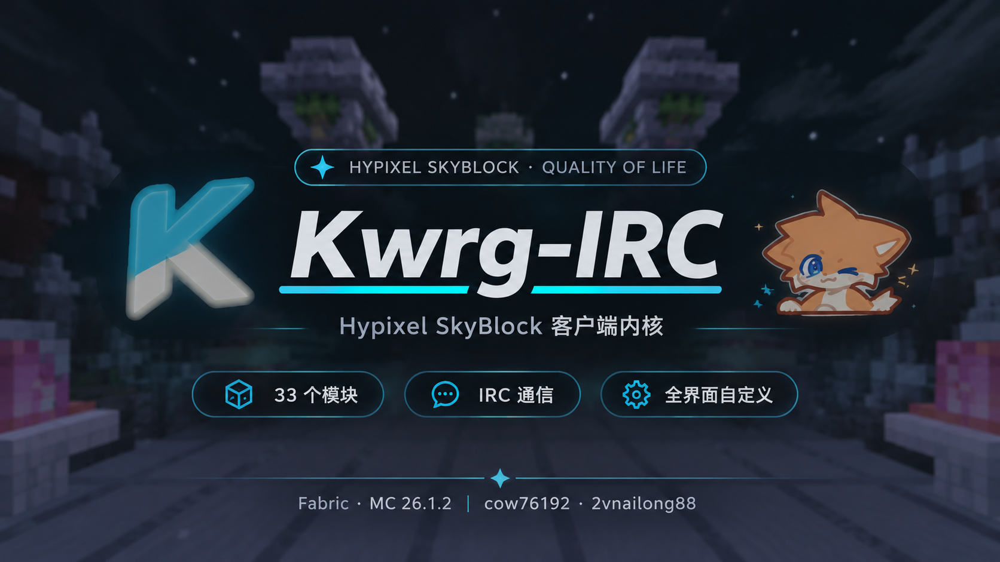

# Kwrg IRC




[](./LICENSE)
[](./src "Total lines in src/**/*.java, including comments and blank lines")

【[devlog] Skyblock QOL IRC Mod - KwrgIRC 26.1.2】 

https://www.bilibili.com/video/BV1Ukxh6NEbi/?share_source=copy_web&vd_source=626a20fc228373f6416c8f5e140c93f0

A Fabric client mod for Hypixel SkyBlock, with built-in IRC chat, waypoint and route management, and a customizable GUI and HUD.

[中文](./README.md) · [Source](https://github.com/cow76192/Kwrg-IRC)

## Installation

The current source targets the following environment:

| Component | Version |
| --- | --- |
| Minecraft | 26.1.2 |
| Java | 25 or later |
| Fabric Loader | 0.19.3 or later |
| Fabric API | Compatible with Minecraft 26.1.2 |
| owo-lib | 0.13.1+26.1 |

1. Install Fabric Loader for Minecraft 26.1.2.
2. Place the Kwrg mod JAR and the matching Fabric API JAR in your game's `mods/` folder.
3. Install the matching version of owo-lib. The build also includes owo-sentinel, which can guide installation if owo-lib is missing.
4. Launch the game and enter a world. Press **Right Shift** or run `/irc gui` to open the interface.
5. ENJOY your GAME

The mod relies on Skyblocker to load the item repo, and is compatible with SkyHanni.
Hypixel Mod API is bundled with the mod and does not need to be installed separately. Configuration, routes, waypoints, and other local files are stored in the `kwrg/` folder inside your game directory.

## Features

### IRC chat

- Public lobby and custom channels, with controls for listening channels and the current message destination.
- Custom tags, name and message styles, and notification sounds.
- Online player list, alerts for followed players, and typing indicators.
- Send totem effects to other players.
- Emoji shortcodes such as `:skull:` and `:joy:`.
- Sharing of configuration profiles, styles, and private channel invitations.
- `chatSuffix`: adds a custom prefix and suffix to IRC messages, can follow the message style, and offers preset suffixes; when public sync is on, public chat and channel commands such as `/ac` and `/pc` get the same decoration (public chat drops color codes).

IRC uses the project's own service and a JSON protocol over TCP. Chat and player appearance synchronization require a connection to that service.

### Waypoints and routes

- Separate waypoint and route editing screens.
- Manage multiple waypoint sets and choose which SkyBlock islands they appear on.
- Create and edit routes, with nodes and connecting lines displayed in the world.
- Built-in Kuudra pearl route.
- Detect coordinates in chat and use a message button to display a temporary waypoint and automatic pathfinding.
- Enable quick editing, then **Alt + left-click a block** to add a route node.

### Interface and HUD

- Radial menu, module settings panels, custom theme colors, opacity, and GUI scaling.
- Customizable background blur for the main interface.
- Dynamic Island HUD showing FPS, latency, TPS, memory usage, and hardware metrics.
- Custom Tab overlay and scoreboard styling.
- HUD layout editor with dragging, snapping, and position reset.
- Load local TTF / OTF fonts without restarting the game.
- Inventory HUD: a persistent inventory panel with background and slot opacity, hotbar inclusion, slot backgrounds, GUI theme colors, empty-inventory hiding, spacing, and corner radius; position and scale it in the HUD editor.
- Player doll HUD: renders your own player model on screen with independent opacity and scale; the model turns with your view.

### Title screen

- 3D menu: browse servers and single-player worlds in a portal scene, then connect or enter directly.
- Portal transition when connecting, with abort and return-to-server-list buttons.
- Custom button styling and hover effects; switch between the classic and 3D menus and choose which one appears at startup.
- A custom startup loading screen.

### Player display

- Custom static or animated capes, model scaling, and armor hiding by slot.
- Glow effects and colors for IRC players.
- Local nickname and Hypixel rank display overrides.
- `antiNick`: automatically scan the current Hypixel lobby, server changes, and joining players for UUID/skin mismatches. Hover over alerts for evidence. Account guesses are unverified skin sources; preset skins cannot identify the player. Toggle or rescan with `/irc functions antiNick [true|false|scan]`.
- Player tracking, automatic party tracking, and on-screen radar.

Appearance settings such as capes and model scaling can be synchronized over IRC with other players using the mod. Nickname and rank overrides affect only your local display.

### Assistive cheats

- `ESP`: outlines players, monsters, animals, and other entities with a translucent fill; toggle each category, hide specific ones, and set the outline color. The `other` category also covers chests.
- `gemstoneESP`: marks gemstone blocks in the Crystal Hollows, with a 16–128 block scan range, opacity, and filters for Ruby, Amber, Jade, Jasper, Amethyst, and Topaz.
- `wormLavaESP`: marks flowing lava at Y ≥ 64 in the Sapphire area, with configurable color and opacity.
- `Glacite Adventurer`: marks Adventurer armor stands in Glacite mineshafts by armor color, with labels and waypoints; ESP then only covers monsters and animals.
- `AutoHarp`: automatically completes the Harp minigame, clicking each note column with a configurable base delay and random jitter.
- `experiments`: automatically completes the Chronomatron and Ultrasequencer experiments, with a configurable base delay and random variation.
- `danceroom`: performs the Dance Room sequence (move, sneak, jump, punch) on the beat, with jump/punch lead ticks, a drift dead zone, and rotation direction.
- `AutoPurchasePass`: clicks `Click to buy a new pass` automatically, with a 6-second cooldown.
- `refill`: keep a target count of an item in your inventory, with per-item target, auto interval, hotkey, and island filters, plus a global `/gfs` cooldown; open with `/irc functions refill`; auto mode requires the skyblock-repo-cache folder.
- `freecam`: detaches the camera for free flight, with a configurable speed of 1–100 blocks per second and a temporary speed boost while holding Ctrl; use `/irc functions freecam [true|false]`.

### Window projection

- `window`: projects another desktop window into the world, with size, distance, offset, follow-camera, through-walls, and curved-screen options; native input lets you operate it by right-click or Alt+G. Windows x64 only.

### DEBUG
- Connect to and disconnect from IRC, and measure the current latency.
- Toggle GUI background blur, and adjust blur quality and radius.
- Limit the GUI frame rate to reduce resource usage while the interface is open.
- Tune the pathfinding heuristic weight, trading search speed against path quality.
- Tune the anti-aliasing strength of the Dynamic Island.
- Clear the item index cache, reload the item repository, or clear the cape cache.
- Choose whether the 3D or classic menu appears at startup, and whether other screens reuse the custom button style.

## Common commands

### Chat

| Command | Description |
| --- | --- |
| `/chat irc` | Enter IRC chat mode; subsequent regular chat input is sent to IRC |
| `/ic <message>` | Send one message to the current IRC destination |
| `/icall <message>` | Send one message to the public lobby |
| `/ci all` | Switch the chat destination to the public lobby |
| `/ci channel <name>` | Join a channel and switch the chat destination to it |
| `/irc online` | List online IRC players |
| `/irc coords` | Send your current position, island, and server information |

On Hypixel, use another `/chat` command, such as `/chat all`, to leave IRC chat mode and return to game chat.

### Interface and settings

| Command | Description |
| --- | --- |
| `/irc` | Show command help |
| `/irc gui` | Open the main interface; the default shortcut is Right Shift |
| `/irc hudeditor` | Open the HUD layout editor |
| `/irc rank <tag>` | Set your IRC tag |
| `/irc nameStyle <style>` | Set your name style |
| `/irc messageStyle <style>` | Set your message style |
| `/irc important [player]` | Manage followed players |
| `/irc config create <name>` | Create a configuration profile |
| `/irc config load <name>` | Load a configuration profile |
| `/irc config save` | Save the current configuration profile |
| `/irc share open` | Open the sharing interface |
| `/irc debug connect` | Connect to IRC |
| `/irc debug disconnect` | Disconnect from IRC |
| `/irc debug ping` | Check IRC latency |

### Route editing

These commands modify the currently selected route. Node indices start at **1**.

| Command | Description |
| --- | --- |
| `/route show` | List the current route's nodes |
| `/route add <name> [x y z]` | Append a node; omit coordinates to use your current position |
| `/route ins <name> <before> <after>` | Insert your current position between two adjacent node indices |
| `/route del <index>` | Delete a node by index |
| `/irc routeEdit [true\|false]` | Toggle quick editing or explicitly enable or disable it |

### Feature commands

| Command | Description |
| --- | --- |
| `/irc functions freecam [true\|false]` | Toggle freecam; omit the argument to switch |
| `/irc functions refill` | Open the auto-refill screen |
| `/irc functions antiNick [true\|false\|scan]` | Toggle antiNick or scan immediately |
| `/irc functions hideArmor [head\|chest\|legs\|feet] [true\|false]` | Hide all armor or one slot; omit arguments to show status |
| `/irc functions glowColor [color]` | Set or show the IRC glow color |
| `/irc play <player> <item>` | Send a totem animation to a player |
| `/irc waypoint chat <x> <y> <z> <label>` | Create a temporary waypoint from chat coordinates |

## Local files

All paths below are relative to your game directory. Some files and folders are created when you first use the corresponding feature.

| Path | Contents |
| --- | --- |
| `kwrg/config.json` | Selection of the current configuration profile |
| `kwrg/<profile>.json` | Settings for each configuration profile |
| `kwrg/routes/` | Route files |
| `kwrg/wayPoints/` | Waypoint sets |
| `kwrg/font/` | Custom TTF / OTF fonts |
| `kwrg/capes/cache/` | Cape cache |

Before saving routes and waypoints, the mod checks the file contents on disk. If it detects external changes, it prompts you to avoid overwriting them directly.

## Building from source

Requires **JDK 25**.

Windows (PowerShell):

```powershell
.\gradlew.bat build
```

Linux / macOS:

```bash
./gradlew build
```

Build artifacts are written to `build/libs/`. Install the mod JAR without the `-sources` suffix.

## Authors and license

- Project authors: cow76192 and 2vnailong88.
- Mod metadata credits: Grwk and Kwrg.
- Licensed under the [MIT License](./LICENSE).
