# Kwrg IRC

<p align="center">
  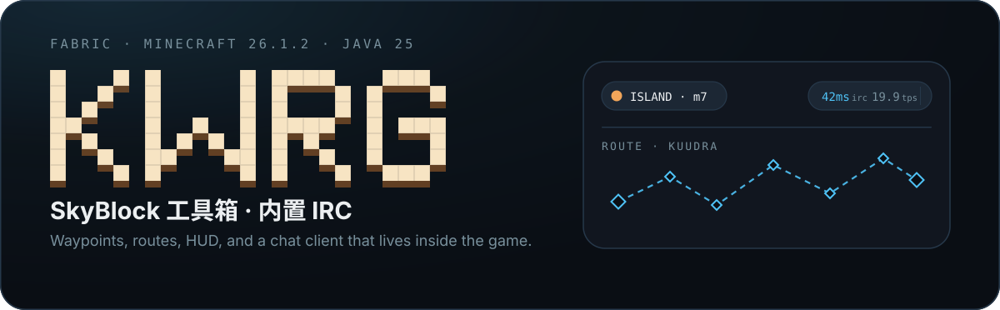
</p>

<p align="center">
  <a href="./README.md"></a>
  <a href="./README.en.md"></a>
  &nbsp;
  
  
  
  
</p>

**Kwrg 是一个 Fabric 客户端模组。** 它把 Hypixel SkyBlock 的日常操作——记点、跑线、盯人、看状态——和一个自建的 IRC 聊天客户端，装进同一套自绘界面里。

界面不是原版屏幕的换皮：从径向菜单、三级面板、灵动岛到世界里的光柱和连线，都是这个模组自己画的。

---

<p align="center">
  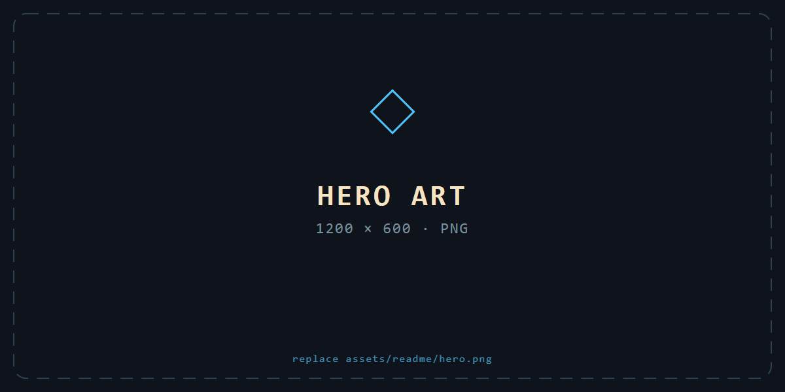
</p>

---

## 三秒看懂

| 你想做的事 | Kwrg 给的 | 相关模块 |
| --- | --- | --- |
| 在游戏里跟朋友聊天 | 内置 IRC：频道、昵称、表情、披风、发光 | `channel` `customCape` `glowColor` |
| 记点、跑线 | 路径点集、路线编辑、寻路引导线 | `waypoint` `route` |
| 盯住某几个人 | 目标名单、队伍自动追踪、屏幕雷达 | `playerFinder` |
| 改掉看不顺眼的界面 | 灵动岛 HUD、Tab 与记分板重皮、字体、主题色 | `dynamicIsland` `dynamicTab` `dynamicScoreboard` `font` `guiStyle` |
| 让名字看起来不一样 | 昵称与 Hypixel Rank 伪装（纯客户端） | `Nick` |
| 给自己换身行头 | 自定义披风、模型缩放、隐藏盔甲 | `customCape` `modelScale` `hideArmor` |

---

## 它是什么

Kwrg 的重心不在"再加一个功能"，而在两件事：

**一、把聊天做进游戏里。** 模组连着一个自建 IRC 服务，用一套自定义的 JSON 协议（TCP，换行分隔）。它不只是发消息——频道、表情短码、披风、发光、隐藏盔甲、模型缩放、打字状态、关注玩家的弹窗，全部走这条链路。这些状态由客户端决定并广播，服务端只做转发。

**二、把界面当成一个正经的渲染问题。** ClickGUI 挂在 owo-lib 上，但抗锯齿几何、透明度管线、圆角与阴影、字体热插拔都是自己写的。HUD 的灵动岛、Tab 面板和记分板不是贴图，而是在原版渲染流程里接管绘制。

> 版本：Fabric Loader ≥ 0.19.3 · Minecraft 26.1.2 · Java 25 · 36 个模块 · 34 个 mixin 注入点 · 约 28,500 行 Java

<p align="center">
  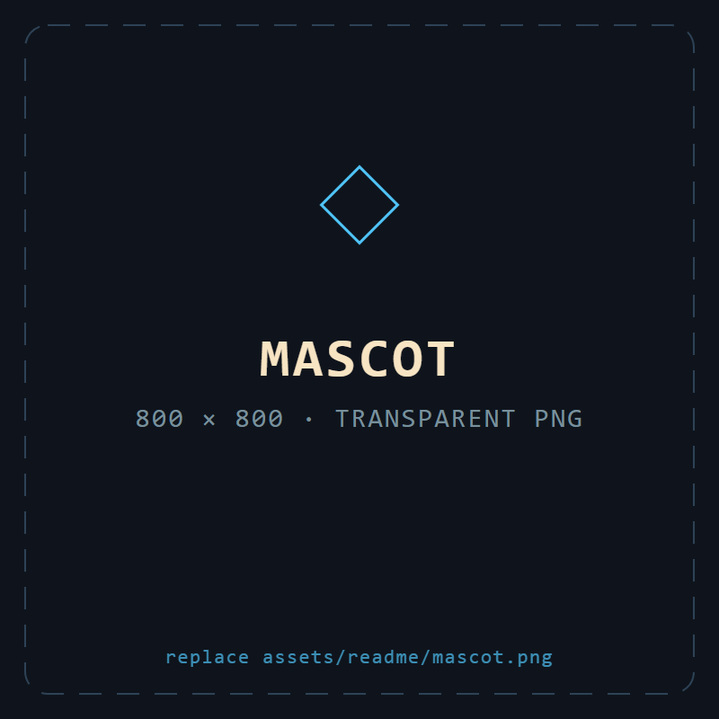
</p>

---

<p align="center">
  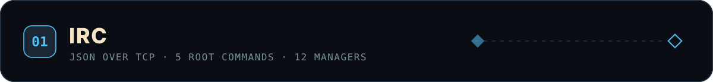
</p>

### 一句话

聊天框不只是聊天框。把 `/chat irc` 打开之后，**你输入的每一行都会直接变成 IRC 消息**；再发一次别的 `/chat` 就退出。

```
/chat irc        → 之后的聊天输入直接进 IRC
/ic <消息>       → 只发这一次
/icall <消息>    → 强制发公共大厅
/ci              → 在已存频道与公共大厅之间来回切
```

<p align="center">
  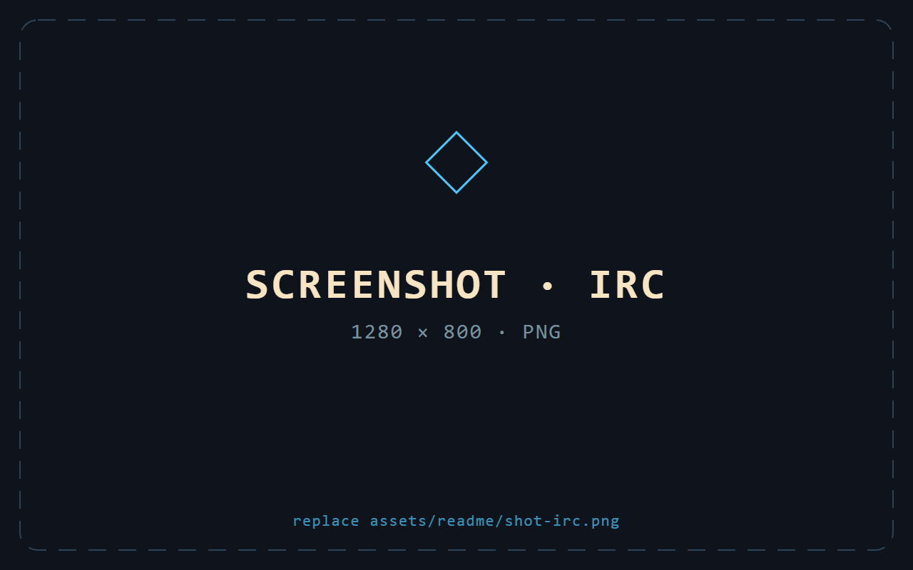
</p>

### 命令速查

| 命令 | 作用 |
| --- | --- |
| `/ci` · `/ci all` · `/ci channel [名称]` | 切频道 / 回公共大厅 / 指定频道 |
| `/ic <消息>` · `/icall <消息>` | 单发一条 / 强制发公共大厅 |
| `/irc coords` | 把当前坐标、岛屿、服务器发到 IRC |
| `/irc rank <称号>` · `/irc nameStyle <样式>` · `/irc messageStyle <样式>` | 称号与文字样式 |
| `/irc play <玩家> <物品>` | 给对方播一个物品 / 图腾动画，也支持图片 URL |
| `/irc important [玩家]` | 关注名单：对方说话时弹大字 |
| `/irc online` | 在线列表 |
| `/irc config load \| create \| save` | 配置档案 |
| `/irc share` | 把配置 / 样式 / 频道邀请发给某个玩家 |
| `/irc routeEdit [true\|false]` | 切换 Alt + 左键快速加点 |
| `/irc gui` · `/irc hud` | 打开主界面 / HUD 布局编辑器 |
| `/irc functions hideArmor` · `glowColor` | 隐藏盔甲 / 发光颜色 |
| `/irc debug connect \| disconnect \| ping` | 连接、断开、测延迟 |

### 几个不太显然的设计

**协议是「默认聊天 + 显式类型」。** 一共 23 种消息类型。唯一的例外是聊天消息——它故意不带 `type` 字段，接收端读不到 `type` 时就按聊天处理；其它包都显式声明类型。

**心跳和延迟测量是同一个包。** 每 15 秒一个 `ping`，回包不做完整反序列化（直接字符串匹配），RTT 同时喂给 HUD 和 `/irc debug ping`。断线最多重连 3 次；重连成功后会**一次性重放全部状态**：加入 → 隐藏盔甲 → 模型缩放 → 披风 → 频道 → 在线查询 → 心跳 → 关注名单。

**披风是一个内容寻址的小 CDN。** 选好披风先算 SHA-256，问服务端"这份图你有了吗"；没有才上传 base64，然后广播同步。对方缺图时按哈希回下载。动画参数不另存元数据，直接编码进缓存文件名：`<hash>@帧数#fps.png`。

**视觉能力全在渲染层，不改数据。** 昵称与 Rank 伪装掐在字体层（先把别人身上的旧前缀吃掉再重画）；隐藏盔甲让 `getItemBySlot` 返回空；发光走 `isCurrentlyGlowing` 与 `getTeamColor`。所以这些效果服务端完全看不见，断线即全部复原。

**聊天里的坐标可以变成路。** 任何消息里出现 `x: 1 y: 2 z: 3`（或裸三元组），消息尾部会多一个 `[show waypoints]` 按钮。点一下生成光柱 + 异步 A* 算出的引导线，走近 3 秒自动消失。

**表情是 1024 条短码。** `:skull:` `:joy:` `:fire:` 这样发，发送前替换成 Unicode；IRC 消息与公屏聊天都生效。

---

<p align="center">
  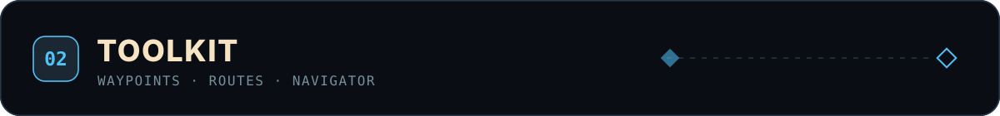
</p>

### 路径点与路线

两套东西，用同一个双页界面管理：

- **路径点集**：一组坐标，可以按岛屿过滤生效范围。默认集受保护，最多 64 点。
- **路线**：有顺序的节点链，可以开"连线"把整条路线画出来。内置一份 Kuudra 珍珠路线（57 个点），首次启动时释放到磁盘。

写盘是原子的：先写临时文件再替换；写之前比对磁盘内容，**文件被外部改过就拒绝覆盖**。

```
/route show                 列出节点
/route add <名称> [x y z]   末尾添加（省略坐标 = 当前位置）
/route ins <名称> <前> <后>  在相邻两个索引间插入
/route del <索引>           删除
```

开着 `/irc routeEdit` 时，**Alt + 左键点方块**就能直接加点。

### 寻路不是画直线

聊天坐标、路径点、路线共用的是一套加权 A*：

- 代价 `f = g + h × weight`，权重可在 0.8–2.2 之间调（`navigatorWeight` 模块）。
- 同一次搜索里维护 7 档系数的"尽力而为"节点，队列耗尽时返回推进得最远的那条，而不是直接失败。
- 传送边按 98 个最简方向投射，最长 61 格，代价是 `距离 × 1.6 + 12`；只有站在实地上时才会考虑，且每次搜索有 128 次的预算。
- 走过的路径会进一张 FAVOR 表（上限 4096 条），下次在同一区域代价打折。
- 平滑只在**非传送段**用 Catmull-Rom——传送段如果插值，会把一次瞬移画成一条弧线。

先判直连再搜索：如果起点终点之间站得住、视线通畅，直接返回两点路径，不跑 A*。

<p align="center">
  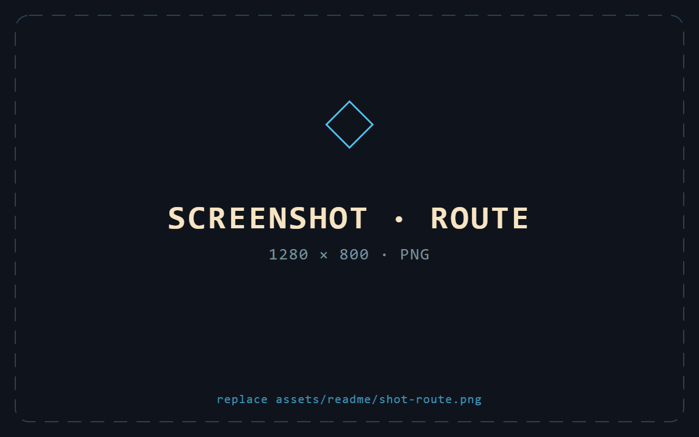
</p>

---

<p align="center">
  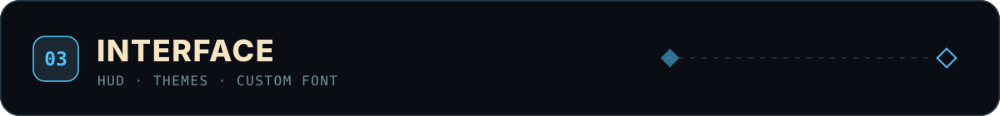
</p>

### 一套自绘的 GUI

打开界面（默认 **右 Shift**）看到的是一个径向菜单：五个分类围成一圈，500ms 展开。点中某个分类，按钮滑到上方让位，二级面板从它的圆心长出来；再右键某个模块，第三级设置面板从行上生长。

<p align="center">
  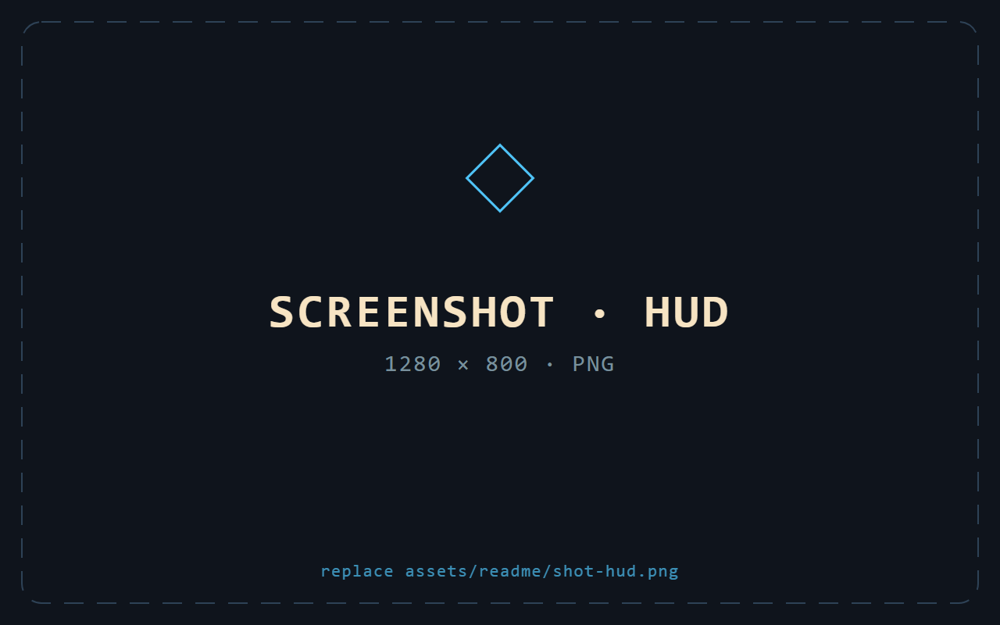
</p>

### 主题不是一张常量表

整套配色只有一个输入：面板底色。其余全部派生——

- 卡片底 = 底色加一档亮度，描边从底色推导；
- "抬升面"（徽章、列表行）不是硬编码色值，而是把标定值与默认底色的**通道差反算**到当前底色上，浅色主题会自动反向偏移；
- 文字该用深色还是浅色，不靠阈值判断，而是实测两套字色在面板底和派生卡片底上的**对比度，取较差的那个再比较**；
- 换色时用 180ms 把二十多组色逐色插值，所以主题是渐变而不是闪变。

### 抗锯齿是手搓的

没有依赖贴图。所有圆角、边框、圆、弧、线都走同一套几何：

- 把 1×1 的 quad 用 pose 缩放拉伸成任意**亚像素**矩形；
- 圆角面板 = 3 个矩形 + 4 个 90° 圆盘；
- 1px 边框的羽化是**两层 ring**：内层从透明渐变到实色，外层实色核；
- 柔和阴影 = 实心圆角核 + 4 条边缘二次渐变 + 4 个径向 ring 渐变。

透明度也不是逐个调用点乘 alpha：它返回一个图形代理对象，在最后一刻改写 alpha 通道。所以任意组件子树整体淡入淡出不需要改任何绘制代码。

### 字体是热插的

扫描 `kwrg/font/` 里的 ttf/otf，反射拿到字体管理器，现场构造一个 TrueType provider，替换掉字体集——**不重载资源包，不重启游戏**。切字体失败会保持原样。

HUD 上那套字体是另一回事：它是打包在模组里的 `kwrg:island`（size 8.0 / oversample 4.0），只给灵动岛和记分板用。

### HUD 用锚点定位

每个 HUD 元素的最终坐标 = `锚点 → 边距 → 偏移 → 夹到屏幕内`。

用户在编辑器里拖动，改的**只是偏移**。所以"重置"只需要把偏移归零，还能播一段从当前位置弹回去的动画。磁吸同时考虑中心线、左右、上下，取 6px 内最近的一个；按住 Ctrl 关闭磁吸。

三个 HUD 元素：灵动岛（默认关闭、20% 透明度，可显示 FPS / IRC 延迟 / 服务器延迟 / TPS / 内存 / GPU / CPU）、通知堆叠、动态记分板。

**Tab 面板是被"量"出来的。** 原版走 `fill` 重定向收集包围盒；装了 Skyblocker 就反射读每个可见 widget 的位置取并集；装了 SkyHanni 就按行列估算。三条路都收敛到同一个边界，再由灵动岛统一画背景、裁剪、位移——松手后还会继续渲染到动画播完。

### 通知

四种类型，各有符号与主色。驻留时长按文本长度自动算：`2500 + 字符数 × 60` 毫秒，钳在 2.5–8 秒之间。鼠标悬停会暂停倒计时，移开继续。

---

## 结构

<p align="center">
  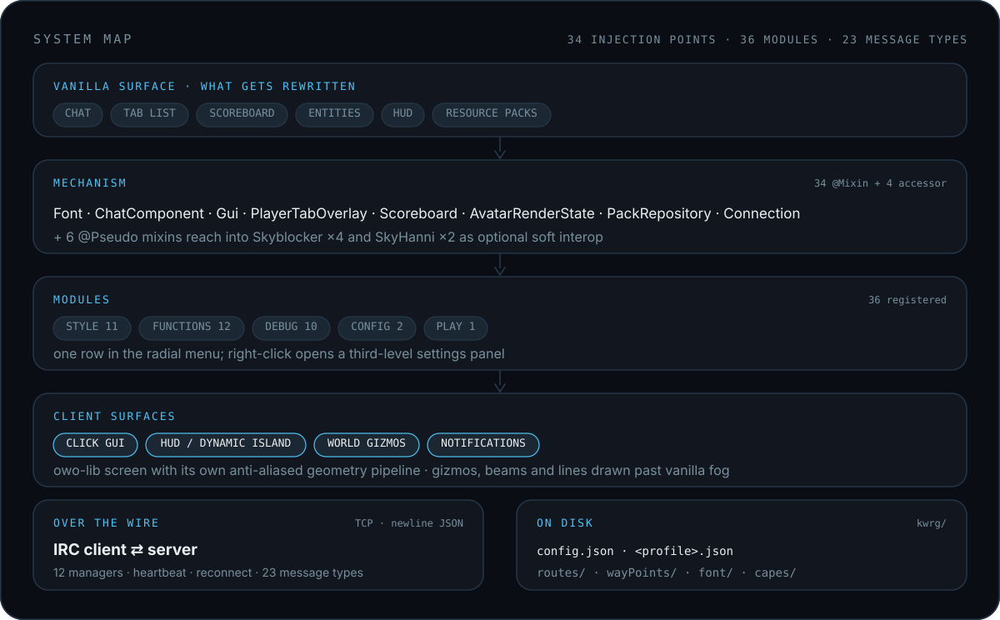
</p>

自上而下：被改写的原版界面 → 34 个 mixin 注入点 → 36 个模块 → 客户端表面层。最下方两条是并行的：IRC 链路（TCP + 换行 JSON）与本地 `kwrg/` 目录。

---

## 安装

需要 **Minecraft 26.1.2**、**Fabric Loader ≥ 0.19.3**、**Java 25**。

1. 装好 Fabric Loader；
2. 把构建出的 jar 放进 `mods/`；
3. 启动游戏。

Hypixel Mod API 已随包内置，不需要单独安装。

首次启动会在游戏目录下生成 `kwrg/`，里面是配置、路线、路径点集、字体与披风缓存。

打开界面：按 **右 Shift**，或输入 `/irc gui`。

### 从源码构建

```bash
./gradlew build
# 产物在 build/libs/
```

---

## 模块总表

<details>
<summary><b>36 个模块</b>（点击展开）</summary>

| 分类 | 模块 | 作用 |
| --- | --- | --- |
| STYLE | `dynamicIsland` | 灵动岛 HUD：FPS、延迟、TPS、内存、GPU、CPU |
| STYLE | `dynamicTab` | Tab 面板重皮，可跟随灵动岛位置 |
| STYLE | `dynamicScoreboard` | 记分板重皮，可隐藏分数数字 |
| STYLE | `rank` | IRC 称号 |
| STYLE | `nameStyle` | 名字样式（彩虹、渐变、颜色码） |
| STYLE | `messageStyle` | 消息正文样式 |
| STYLE | `chat` | 收到消息时的提示音（7 种，默认幼猫叫） |
| STYLE | `font` | GUI 字体切换 |
| STYLE | `guiStyle` | GUI 主色与透明度 |
| STYLE | `GuiScale` | GUI 缩放 50%–200% |
| STYLE | `hudEditor` | HUD 布局编辑器 |
| FUNCTIONS | `channel` | IRC 频道监听与发言目标 |
| FUNCTIONS | `customCape` | 自定义披风：文件、画布尺寸、动画帧率 |
| FUNCTIONS | `glowColor` | IRC 在线玩家发光与颜色 |
| FUNCTIONS | `hideArmor` | 按部位隐藏盔甲 |
| FUNCTIONS | `modelScale` | 自己的模型大小 |
| FUNCTIONS | `Nick` | 昵称与 Rank 伪装 |
| FUNCTIONS | `chatSuffix` | 公屏前后缀语气词（默认 `喵~`） |
| FUNCTIONS | `importantPlayer` | 关注玩家：对方说话时弹大字 |
| FUNCTIONS | `playerFinder` | 目标名单、队伍自动追踪、屏幕雷达 |
| FUNCTIONS | `online` | IRC 在线列表（带头像） |
| FUNCTIONS | `waypoint` | 路径点集 |
| FUNCTIONS | `route` | 路线 |
| CONFIG | `load` | 配置档案：新建、切换、删除、剪贴板导入导出 |
| CONFIG | `share` | 把配置 / 样式 / 频道邀请发给某个玩家 |
| DEBUG | `connect` `disconnect` | 连接 / 断开 IRC |
| DEBUG | `ping` | 测 IRC 延迟 |
| DEBUG | `disableBlur` | GUI 毛玻璃开关与质量 |
| DEBUG | `FPSLimit` | GUI 限帧 |
| DEBUG | `navigatorWeight` | A\* 启发式权重 0.8–2.2 |
| DEBUG | `DynamicIslandAAValve` | 灵动岛抗锯齿系数 |
| DEBUG | `clearIndexCache` | 清物品索引缓存 |
| DEBUG | `reloadRepo` | 重载物品仓库 |
| DEBUG | `clearCapeCache` | 清披风缓存 |
| PLAY | `play` | 给指定玩家播物品 / 图腾动画 |

</details>

---

## 常见问题

**为什么有些功能和别的模组重了？**  
重的是表象。Kwrg 的 Tab 与记分板重皮是**接管原版绘制**而不是叠加，所以装了 Skyblocker 或 SkyHanni 也能共存——它会先量出对方的布局，再在那块区域里画。

**改配置文件会崩吗？**  
配置文件带迁移器：旧字段会自动迁移，出现未知字段时会先把原始文件备份到 `kwrg/backUp/` 再处理。

**路径点文件被别的工具改过怎么办？**  
写盘前会比对磁盘内容；被外部改过就拒绝覆盖并提示，而不是默默盖掉你的手写内容。

---

## 署名

<p align="center">
  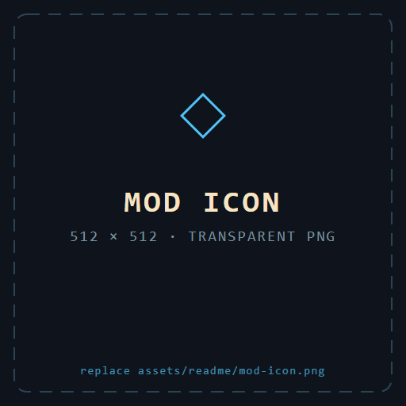
</p>

<p align="center">
  <b>cow76192</b> · <b>2vnailong88</b><br>
  <sub>模组元数据署名：Grwk、Kwrg</sub>
</p>

<p align="center">
  MIT License · <a href="./LICENSE">LICENSE</a>
</p>

<p align="center">
  <sub>w kwrg!</sub>
</p>